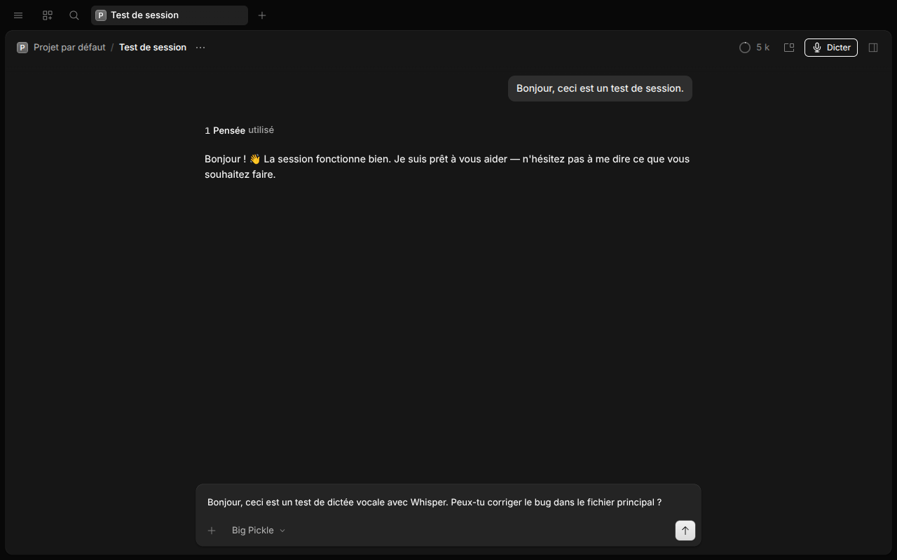

# dictaphone-opencode

Dictée vocale pour **OpenCode Desktop**, avec une vraie icône microphone juste
à côté du bouton d'envoi.




*L'icône micro à côté du bouton d'envoi, et le texte transcrit inséré dans le
prompt sans être envoyé.*

## Ce que fait le plugin

- Icône microphone dessinée en SVG, à côté du bouton d'envoi (icône seule,
  sans libellé), y compris dans le brouillon d'une nouvelle session.
- Raccourci `Ctrl+Maj+M` (ou `Cmd+Maj+M` sur macOS) et commande `/voice`.
- Pastille d'état au-dessus du prompt : écoute, durée, transcription.
- Le texte transcrit est **inséré dans le prompt**, jamais envoyé tout seul.
- Trois moteurs : moteur local intégré, OpenAI, ou tout endpoint compatible
  OpenAI.
- Réglages intégrés dans **Settings › Dictaphone**.
- Audio converti en WAV 16 kHz mono avant l'envoi.
- Transcription locale rapide : ~0,5 s sur GPU, quelques secondes sur CPU.
- Aucun serveur local : le moteur est lancé à la demande par le plugin et
  s'arrête après le délai choisi (1 minute par défaut) pour libérer sa mémoire.

## Comment ça marche

```text
Micro → MediaRecorder → WAV 16 kHz mono → RPC OpenCode → moteur local intégré
                                                       ↓
                          prompt OpenCode ← texte ←────┘
```

Le plugin a deux parties : une partie GUI (icône micro, capture audio,
insertion dans le prompt) et une partie moteur (processus Python lancé à la
demande, dialogue JSON sur l'entrée/sortie standard). Aucun port n'est ouvert,
aucun service système n'est installé. L'audio ne quitte pas la machine en mode
local.

## Performances mesurées

Sur un i9-9900K et une RTX 2080 Ti, phrase française de 7,5 s :

| Configuration | Temps |
|---|---|
| `large-v3-turbo` sur GPU (float16, beam 5) | **~0,5 s** |
| `large-v3` sur GPU (float16, beam 5) | ~1,1 s |
| `small` sur CPU (int8, beam 5) | ~1,6 s |
| `large-v3-turbo` sur CPU (int8, beam 5) | ~4,9 s |

Le modèle `large-v3-turbo` est utilisé par défaut quand un GPU NVIDIA est
détecté : bien plus exact que `small`, notamment sur les noms propres et les
phrases ambiguës. Sur CPU, l'installeur garde `small` pour rester rapide ;
`large-v3-turbo` reste disponible en le demandant explicitement.

## Prérequis

- **OpenCode Desktop 2.2.7 ou plus récent** (API des plugins GUI
  `gui-experimental`).
- **Python 3.12** et [`uv`](https://docs.astral.sh/uv/) pour le moteur local.
  `uv` s'installe en une commande :
  `curl -LsSf https://astral.sh/uv/install.sh | sh`
- Facultatif : un GPU NVIDIA avec un pilote récent pour la transcription locale
  rapide avec `large-v3-turbo`. L'installeur ajoute les bibliothèques CUDA
  nécessaires dans l'environnement virtuel.
- Facultatif : une clé API OpenAI si vous préférez le mode cloud.

> Le moteur local est un processus lancé par le plugin, pas un service.
> L'installeur est prévu pour Linux ; sur macOS ou Windows, utilisez OpenAI ou
> un endpoint compatible. L'icône et l'insertion fonctionnent de la même façon.

## Installation clé en main

```bash
git clone https://github.com/railboz/dictaphone-opencode.git
cd dictaphone-opencode
./install.sh
```

Sur une machine avec GPU NVIDIA, le modèle par défaut est `large-v3-turbo` ;
sinon `small`. Pour forcer un modèle : `./install.sh large-v3`.

Le script :

1. construit le bundle GUI si `dist/` est absent ;
2. installe le moteur local dans `~/.local/share/dictaphone-opencode`
   (environnement Python, modèle pré-téléchargé) — sans service ni port ;
3. ajoute le dossier du plugin à `~/.config/opencode/opencode.json`.

Redémarrez OpenCode Desktop. L'icône micro apparaît à côté du bouton d'envoi
d'une session, y compris dans un nouveau brouillon.

Pour utiliser uniquement OpenAI (sans moteur local) :

```bash
DICTAPHONE_SKIP_SERVER=1 ./install.sh
```

puis renseignez la clé dans **Settings › Dictaphone**.

## Utilisation

1. Ouvrez une session, ou créez une nouvelle session : le bouton est aussi
   disponible dans le brouillon.
2. Cliquez sur l'icône **micro**, appuyez sur `Ctrl+Maj+M`, ou tapez `/voice`.
3. Parlez : l'icône devient rouge. En mode local, le moteur démarre pendant
   que vous parlez, sans bloquer l'enregistrement.
4. Cliquez à nouveau pour arrêter. Le moteur transcrit et insère le texte.
5. Relisez, corrigez si besoin, puis envoyez.

La durée maximale (30, 60, 120 ou 300 s) se règle dans les paramètres.
L'enregistrement s'arrête automatiquement à la limite.

## Réglages

**Settings › Dictaphone** :

| Champ | Rôle |
|---|---|
| Service | `Moteur intégré (sans serveur)`, `OpenAI`, ou `Compatible OpenAI` |
| Modèle local | `auto`, `large-v3-turbo`, `large-v3` ou `small` |
| Libérer la mémoire après | Immédiatement, 30 s, 1 min, 5 min ou 10 min |
| URL du service | Endpoint HTTP pour OpenAI et les services compatibles |
| Modèle | Nom du modèle pour les services compatibles OpenAI |
| Langue | `fr`, `en`, … ou `auto` |
| Clé API | Stockée localement ; vide = utilise `OPENAI_API_KEY` |
| Vocabulaire / contexte | Termes techniques et noms de projets, envoyés comme contexte au moteur |
| Durée maximale | Arrêt automatique de l'enregistrement |

### Moteur local

Le modèle par défaut dépend du matériel : `large-v3-turbo` (~1,6 Go) si un GPU
NVIDIA est détecté, sinon `small` (~500 Mo). Le moteur choisit automatiquement
CUDA/float16 et retombe sur CPU/int8 en cas de problème. Il est lancé au
premier clic sur le micro, reste chaud pendant le délai choisi (1 minute par
défaut), puis s'arrête. Choisissez **Immédiatement après la dictée** pour
libérer la mémoire dès la fin de chaque transcription : le moteur suivant se
recharge pendant que vous parlez.

```bash
./local-server/install.sh large-v3    # précision maximale sur GPU
./local-server/install.sh small       # vitesse maximale sur CPU
```

Le modèle installé est enregistré dans
`~/.local/share/dictaphone-opencode/model`. Le réglage
**Settings › Dictaphone › Modèle local** permet de le remplacer ponctuellement
(`auto` réutilise le modèle installé). Pour vérifier le modèle et le matériel
chargés :

```bash
~/.local/share/dictaphone-opencode/venv/bin/python \
  ~/.local/share/dictaphone-opencode/server.py --prepare
```

En français, le moteur ajoute automatiquement une consigne de style
(« ponctuation, majuscules, accents ») au vocabulaire. Sur 30 phrases
françaises de test, elle fait légèrement baisser le WER (3,72 % contre 3,95 %)
et améliore la capitalisation (90 % contre 83 %) et la ponctuation finale
(80 % contre 77 %), sans ralentir la transcription.

### Mémoire

Mesures sur la RTX 2080 Ti, moteur chargé :

| Configuration | RAM système | VRAM |
|---|---:|---:|
| `large-v3-turbo` float16 | ~0,5 Go | ~2,1 Go |
| `large-v3-turbo` int8_float16 | ~1,3 Go | ~1,15 Go |
| `small` float16 | ~0,5 Go | ~0,7 Go |
| `small` int8_float16 | ~0,6 Go | ~0,45 Go |

Le moteur s'arrête après le délai choisi et libère ces deux mémoires. Pour la
RAM système, le gain principal vient donc de l'arrêt, pas du langage : une
version Rust mesure ~0,4 Go au lieu de ~0,5 Go, avec la même VRAM.
`int8_float16` réduit la VRAM mais augmente la RAM système (quantification),
et `small` réduit les deux au prix de la précision.

### OpenAI

Choisissez `OpenAI`, gardez l'URL
`https://api.openai.com/v1/audio/transcriptions`, mettez votre clé dans le
champ **Clé API**, ou exportez `OPENAI_API_KEY` avant de lancer OpenCode.

### Autre serveur compatible OpenAI

Choisissez `Compatible OpenAI`, puis l'URL de votre serveur (par exemple
`http://127.0.0.1:8080/inference`). Le plugin envoie un `multipart/form-data`
avec `file`, `model`, `language` et `response_format=json`.

## Confidentialité

- En mode local, l'audio ne quitte pas la machine (OpenCode → processus local).
- Aucun port n'est ouvert, aucun service ne tourne en permanence.
- En mode OpenAI, l'audio est envoyé à l'API configurée.
- La clé API est stockée dans le stockage local d'OpenCode, pas dans le code.

## Dépannage

- **L'icône n'apparaît pas** : vérifiez la version d'OpenCode Desktop
  (≥ 2.2.7), la présence du plugin dans `opencode.json`, puis
  `~/.local/share/opencode/log/opencode.log`.
- **Microphone inaccessible** : autorisez le micro dans les réglages du
  système (*Paramètres › Son › Entrée*).
- **Erreur de transcription** : le message affiché reprend la fin de la sortie
  du moteur. Relancez `./install.sh` si l'environnement Python manque.
- **Le GPU n'est pas utilisé** : la commande `--prepare` ci-dessus doit
  afficher `(cuda, float16)`. Vérifiez `nvidia-smi`, puis relancez
  `./local-server/install.sh` pour installer les bibliothèques CUDA dans
  l'environnement virtuel.
- **Texte vide** : parlez plus fort ou augmentez la durée ; le moteur local
  filtre les silences avec VAD.

## Développement

```bash
npm install
npm run build     # bundle GUI dans dist/gui-experimental.cjs
npm run typecheck
```

L'entrée principale du plugin (`src/index.ts`) et le contrat RPC (`src/rpc.ts`)
sont rechargés par OpenCode ; le bundle GUI est rechargé à chaque build.

## Licence

MIT.
